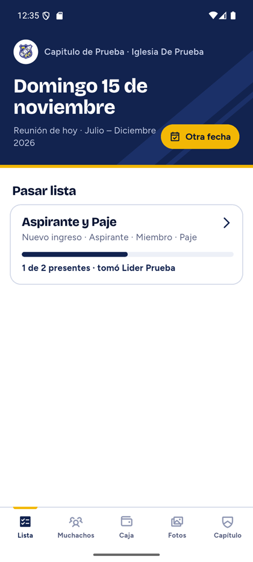
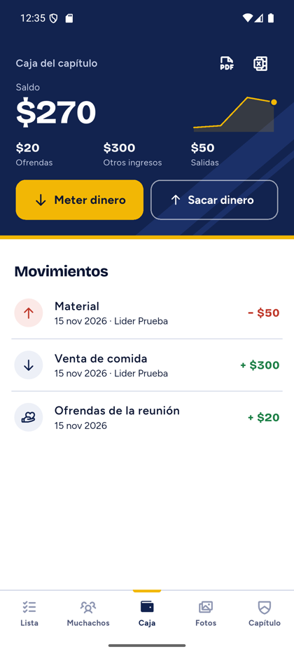
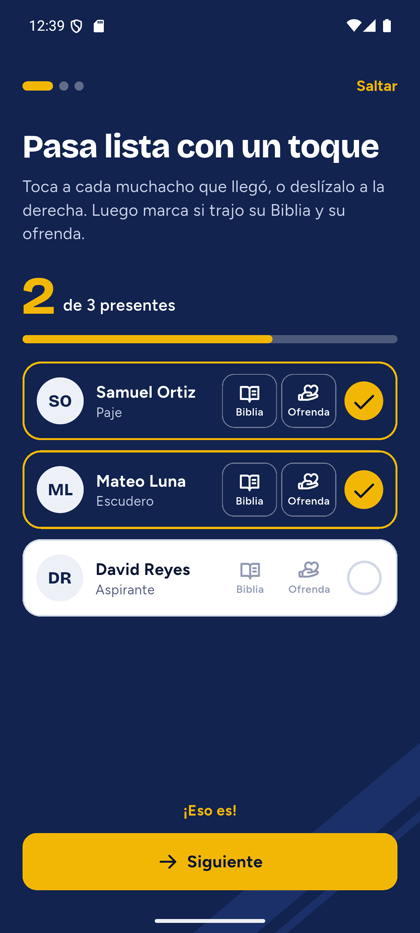
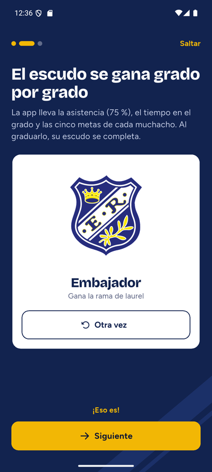
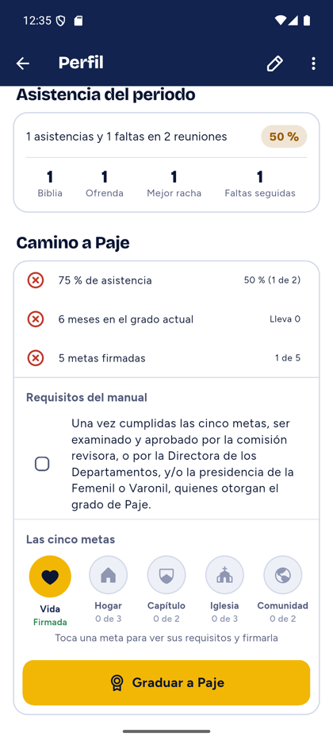
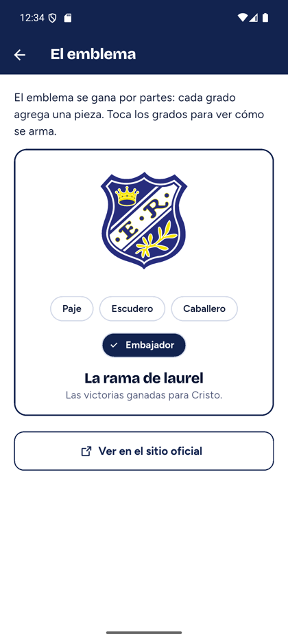
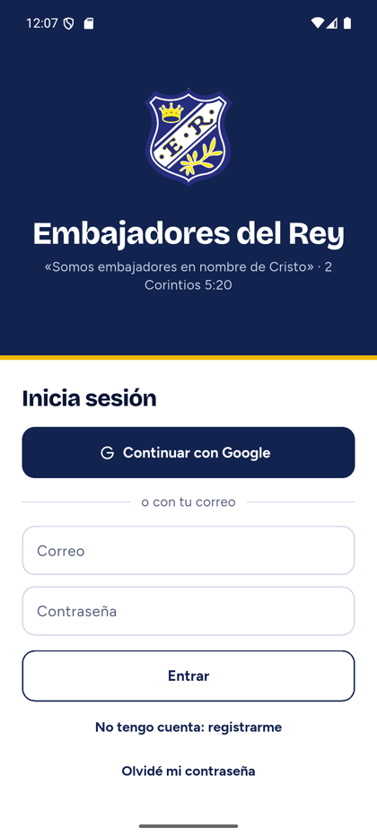
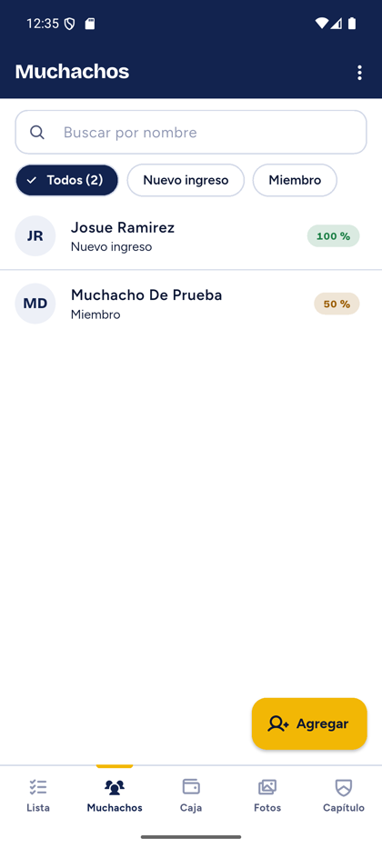
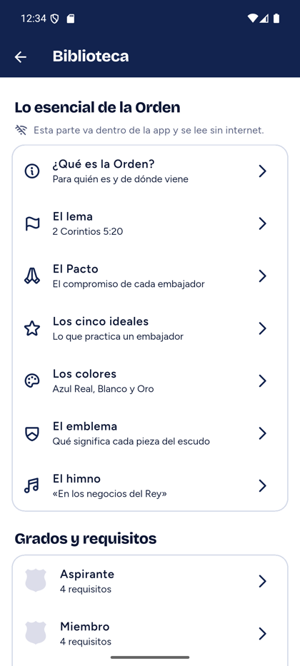

# Embajadores del Rey — app del capítulo

App Android para los consejeros de un capítulo de **Embajadores del Rey**: pasar lista, llevar el avance de grado de cada muchacho conforme al manual, guardar fotos de evidencia y administrar la caja del capítulo. Todo se sincroniza entre los teléfonos del capítulo y funciona sin señal.

<p align="center">
  
  
  
</p>

## Por qué existe

Soy consejero de Embajadores del Rey en mi iglesia y me toca pasar lista. La hoja de papel se olvida, se pierde o se queda en casa, y al final del semestre nadie sabe con certeza quién cumplió el 75 % de asistencia que pide el manual para avanzar de grado.

Esta app nació para resolver eso en mi capítulo, y está hecha para que cualquier otro capítulo la pueda usar: un líder registra su capítulo, invita a sus consejeros con un código y da de alta a sus muchachos.

> **Aviso.** Es un proyecto personal, no una app oficial de la Orden. El escudo, el nombre y el contenido del manual pertenecen a la Orden de los Embajadores del Rey y a las uniones bautistas que la patrocinan. Los requisitos de cada grado se tomaron del sitio público [embajadoresdelreymex.org](https://www.embajadoresdelreymex.org/); ante cualquier diferencia, manda el manual impreso.

## Qué hace

| | |
|---|---|
| **Pase de lista** | Un toque (o deslizar) por muchacho. Se anota si trajo Biblia y cuánto ofrendó. Los demás consejeros lo ven al instante. |
| **Grupos por periodo** | Los grupos juntan uno o varios grados y se rearman cada semestre. Cualquier consejero puede cubrir el grupo de otro; queda registrado quién pasó la lista. |
| **Avance de grado** | Asistencia, tiempo en el grado y las cinco metas, con los requisitos del manual para marcar uno por uno. La meta se firma cuando están completos. |
| **Muchachos** | Datos de cada uno: grado, fecha de nacimiento, papás o tutores con teléfono, domicilio, notas y foto. Llamada, WhatsApp y mapa desde su perfil. |
| **Caja** | Saldo del capítulo: ofrendas de las listas, entradas (con cómo se consiguió) y salidas (con para qué). Reporte en PDF, hecho de tablas con el saldo corrido, y en Excel. |
| **Fotos** | Evidencias de cada reunión, tomadas desde la app. Las de actividades pasadas se guardan con su fecha, y la fecha y la descripción se pueden corregir después. |
| **Cumpleaños** | El teléfono de cada consejero avisa el día que un muchacho cumple años, y el inicio muestra los de las próximas dos semanas. |
| **Mi perfil** | Cada consejero pone su nombre y su foto, que ve el resto del equipo. |
| **Historial** | Cada día en que se pasó lista: cuántos fueron, y al abrirlo, quién asistió y quién faltó en cada grupo. |
| **Reportes** | Porcentaje por muchacho y por grupo, alerta de faltas seguidas, PDF y Excel. |
| **Biblioteca** | Lo esencial de la Orden y los requisitos de los nueve grados dentro de la app; cuadernillos y manual como descargas opcionales desde su enlace oficial. |
| **Tutorial** | La primera vez, tres pasos en los que se practica con la app. |

<p align="center">
  
  
  
  
</p>

<p align="center">
  
  
  
</p>

Ejemplo del reporte de caja: [docs/reporte_caja_ejemplo.pdf](docs/reporte_caja_ejemplo.pdf) (datos ficticios).

## Quién puede hacer qué

- **Líder.** Crea el capítulo. Además de todo lo que hace un consejero, es el único que puede borrar (muchachos, grupos, periodos, movimientos de caja), quitar accesos, nombrar a otro líder, usar *Empezar de nuevo*, que deja el capítulo en blanco, y borrar el capítulo entero.
- **Consejero.** Entra con un código de invitación. Pasa lista de cualquier grupo, da de alta muchachos, arma periodos y grupos, firma metas, registra entradas y salidas de caja e invita a otros consejeros. Puede abandonar el capítulo cuando quiera.

Estas reglas no dependen de la app: están en `firestore.rules` y el servidor las hace cumplir.

## Cómo está hecha

- **Flutter** (Android), con Riverpod para el estado.
- **Firebase**: Auth (correo y Google) y Cloud Firestore con caché local. No usa Cloud Functions ni Storage, así que corre completa en el plan gratuito.
- **Fotos dentro de Firestore.** Se reducen en el teléfono (`lib/services/fotos.dart`); la miniatura va en el documento de la galería y la foto grande en otro que solo se lee al abrirla.
- **Sin señal.** Los cambios se guardan en el teléfono y suben solos al volver la conexión.
- **Avisos de cumpleaños sin servidor.** Cada teléfono programa sus propias notificaciones con la lista de muchachos que ya tiene sincronizada (`lib/services/avisos.dart`).
- **Actualizaciones.** Al abrir, la app consulta la última versión publicada en este repositorio (*Releases*) y, si hay una más nueva, ofrece descargar el APK (`lib/services/actualizacion.dart`).
- **Diseño.** Blanco, azul marino y oro, en colores planos; la franja diagonal del escudo es el motivo de los encabezados. Tipografías Bricolage Grotesque y Figtree, e iconos [Phosphor](https://phosphoricons.com/), incluidos en la app.

```
lib/
  core/       grados y requisitos, cálculo de asistencia, caja, manual, tema, iconos
  models/     capítulo, miembro, periodo, grupo, muchacho, lista, evidencia, movimiento
  services/   acceso a Firebase, estado, fotos, exportación a PDF y Excel
  features/   pantallas
  widgets/    componentes compartidos y animaciones
assets/manual/requisitos.json   requisitos de cada grado
firestore.rules                 quién puede leer y escribir cada cosa
pruebas_reglas/                 pruebas de las reglas contra el emulador
test/                           pruebas de los cálculos, la caja, el manual y el PDF
```

## Ponerla a funcionar

Necesitas Flutter 3.50 o más reciente, Node y una cuenta de Firebase.

1. Crea un proyecto en [Firebase](https://console.firebase.google.com/), activa **Authentication** (correo y Google) y **Firestore**.
2. Conecta la app. Esto genera `lib/firebase_options.dart` y `android/app/google-services.json`, que no están en el repositorio:
   ```
   dart pub global activate flutterfire_cli
   flutterfire configure --platforms=android
   ```
3. Publica las reglas:
   ```
   firebase deploy --only firestore:rules
   ```
4. Para entrar con Google, registra en Firebase la huella SHA-1 de tu llave de firma.
5. Corre o compila:
   ```
   flutter run
   flutter build apk --release --split-per-abi --no-tree-shake-icons
   ```

`--no-tree-shake-icons` hace falta porque los iconos se declaran sobre las fuentes de Phosphor.

## Pruebas

```
flutter test                      # asistencia, avance, caja, cumpleaños, versiones, manual y PDF
cd pruebas_reglas && npm install && npm test   # reglas de seguridad
```

Las pruebas de reglas levantan el emulador de Firestore y revisan, entre otras cosas, que nadie de otro capítulo lea nada, que un código vencido no deje entrar y que solo el líder pueda borrar.

## Créditos

Hecho por **Jean Paul Gallegos Cruz** — [LinkedIn](https://www.linkedin.com/in/jeanpaulgc).

Para los capítulos de Embajadores del Rey. *«Somos embajadores en nombre de Cristo»*, 2 Corintios 5:20.
